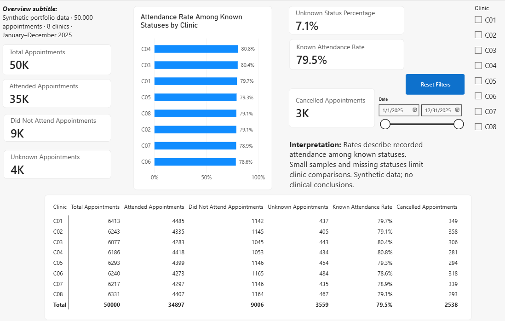
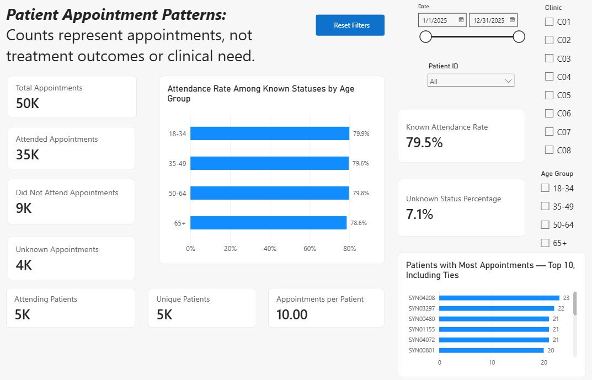
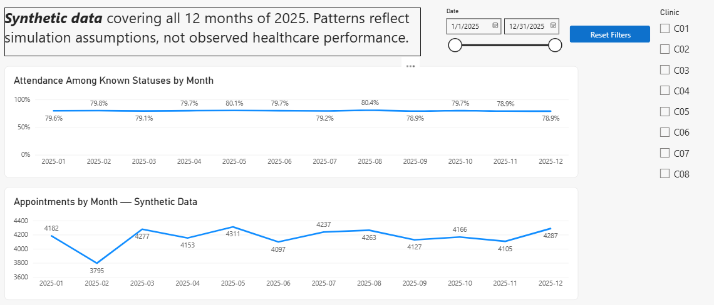
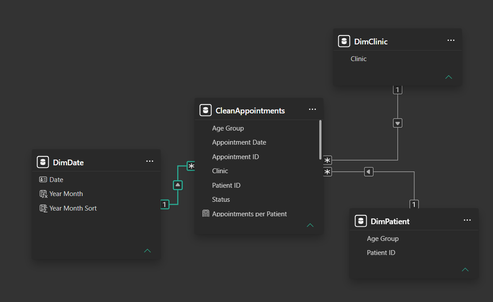
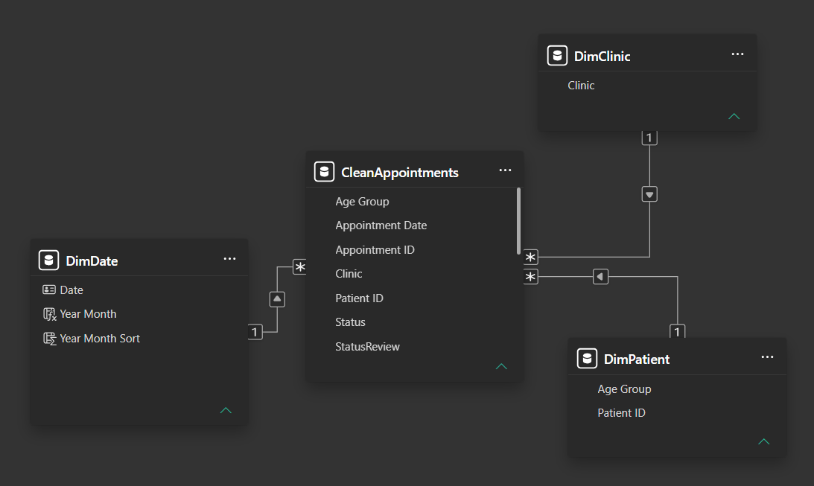

# Clinic Appointment Attendance

A healthcare analytics portfolio project using Excel, Power Query, Python/Pandas, SQLite, and Power BI to explore appointment attendance and data quality. All patient records are synthetic.

## Working together

See the [client workflow and three example engagements](docs/client-workflow.md) for discovery, scope, data-quality decisions, verification, revisions and handover. These are illustrative proposals, not completed client case studies.

## Versions

| Version | Data | Report source |
|---|---|---|
| V1 | 15 appointments, 7 patients, 2 clinics; 1 September–21 October 2026 | Saved Excel output |
| V2 | 50,000 appointments, 5,000 generated patients, 8 clinics; January–December 2025 | Validated, enriched CSV |

V2 adds reproducible data generation, controlled issue injection, cleaning verified against a clean reference, patient enrichment, constrained SQLite storage, and SQL reporting. V1 remains available as the small reference example.

## V2 preview






## Workflow

1. Generate 5,000 patients and 50,000 appointments using a fixed random seed.
2. Introduce 200 status-formatting changes and 100 extra exact duplicate rows; save an issue log.
3. Remove exact duplicates, standardize statuses, and compare every cleaned record with the clean reference.
4. Enrich appointments through a validated many-to-one patient merge; reject unmatched patients.
5. Build SQLite tables with primary keys, foreign keys, and approved-status constraints.
6. Export clinic summaries from the SQL view and report the enriched CSV in Power BI.

The dirty input has 50,100 rows; cleaned and enriched outputs each have 50,000. SQLite and Power BI consume separate outputs of the same validated data; Power BI does not connect directly to SQLite.

## Run V2

Download or clone the complete repository. Open a terminal in its root folder. Use Python 3.14, the development version, with the pinned packages in `requirements.txt`. Other Python versions require compatible dependencies.

### Windows PowerShell

```powershell
py -m venv .venv
.\.venv\Scripts\python.exe -m pip install -r requirements.txt
.\.venv\Scripts\python.exe run_pipeline.py
```

### macOS / Linux

```bash
python3 -m venv .venv
.venv/bin/python -m pip install -r requirements.txt
.venv/bin/python run_pipeline.py
```

No environment activation is required. The runner uses its own Python interpreter for all six scripts and stops on a failed step.

Each successful run regenerates the synthetic CSVs, rebuilds `data/synthetic/appointments.db`, and exports `outputs/synthetic/clinic_summary.csv`. Existing synthetic artifacts are regenerated; the V1 database, workbook, and reports are separate.

The database loader builds and validates a temporary database before replacing the previous synthetic database. If that build fails, the existing database is retained. Earlier CSV stages are not rolled back if a later step fails; refresh Power BI only after the entire run succeeds. Close applications holding the synthetic database open before rebuilding it.

To run the database stage independently:

```powershell
.\.venv\Scripts\python.exe scripts/load_synthetic_database.py --replace
.\.venv\Scripts\python.exe scripts/export_sql_summary.py
```

Without `--replace`, the loader refuses to overwrite an existing database. Its table definitions come from the included V1 database, `data/appointments.db`. The exporter creates the reporting view when absent.

## Open and refresh Power BI

### V2

1. Open `Clinic_Appointment_Attendance_V2.pbix` in Power BI Desktop.
2. Select **Home → Transform data → CleanAppointments → Advanced Editor**.
3. Set the `File.Contents` path to your local `data/synthetic/appointments_enriched.csv`. Preserve the remaining transformations and column names.
4. Select **Close & Apply**, then clear report filters and use the full 2025 date range.
5. After later successful pipeline runs, select **Home → Refresh** in Power BI.

The pipeline refreshes data files and SQLite, not the PBIX. Power BI Desktop refresh is a separate step. The imported report can be explored before refreshing; the stored source path must be updated on another computer.

### V1

Open `Clinic_Appointment_Attendance.pbix`. Repoint its Excel source to `Clinic_Appointment_Attendance.xlsx` on your computer. After editing source records, refresh Excel queries, wait for completion, save the workbook, and refresh Power BI.

## Report features

- Overview: status counts, known-status attendance, unknown percentage, and clinic comparison.
- Patient Detail: patient counts, age-group comparison, searchable patient slicer, and Top 10 appointment counts including ties.
- Patient Records: patient drillthrough with appointment-level records.
- Monthly Trends: appointment counts and attendance rates across the calendar year.
- Definitions: metric explanations and interpretation notes.
- Star schema: patient, clinic, and date dimensions with active one-to-many relationships.
- Synced slicers, contextual tooltips, and reset bookmarks.

## Metrics

| Metric | Definition |
|---|---|
| Total appointments | All appointment records in the selected context, including Cancelled and Unknown |
| Known attendance rate | Attended ÷ (Attended + Did Not Attend), displayed as a percentage |
| Unknown percentage | Unknown ÷ total appointments, displayed as a percentage |
| Unique patients | Distinct patients with an appointment in the selected context |
| Attending patients | Distinct patients with at least one Attended appointment in the selected context |
| Appointments per patient | Total appointments ÷ unique patients |

Counts return zero for empty selections. Rates are blank when their denominator is zero. Unknown and Cancelled are excluded from the known-attendance denominator. SQL export percentage columns use a 0–100 scale; Power BI rate measures store proportions and format them as percentages.

## Validation and expected results

The generator checks IDs, required values, allowed statuses, dates, and reference membership. Cleaning checks complete equality with the original synthetic reference. Enrichment checks lookup uniqueness and unmatched records. Database loading checks row count, foreign keys, and SQLite integrity. SQL export checks eight clinic rows and a total of 50,000 appointments.

V2's default generator produces:

| Status | Appointments |
|---|---:|
| Attended | 34,897 |
| Did Not Attend | 9,006 |
| Unknown | 3,559 |
| Cancelled | 2,538 |
| **Total** | **50,000** |

The known attendance rate is approximately **79.5%** and the Unknown percentage is **7.1%**. The SQL clinic export can be reconciled with the Power BI matrix.

For the V1 snapshot, run `py sql/verify_setup.py` (or `python3 sql/verify_setup.py`). It rebuilds the SQL snapshot in memory and checks 15 appointments and foreign-key integrity. V1 contains 10 Attended, 3 Did Not Attend, and 2 Unknown appointments: 76.9% known attendance and 13.3% Unknown.

## Files

| Path | Purpose |
|---|---|
| `run_pipeline.py` | Runs generation through SQL export |
| `scripts/` | Generation, issue injection, cleaning, enrichment, database loading, and analysis utilities |
| `requirements.txt` | Pinned Python dependencies |
| `data/synthetic/` | Generated clean reference, dirty input, issue log, processed CSVs, reference tables, and V2 database |
| `outputs/synthetic/clinic_summary.csv` | V2 SQL reporting output |
| `data/appointments.db` | V1 database and reusable constrained table definitions |
| `sql/setup.sql` | V1 schema, records, and reporting-view snapshot |
| `sql/clinic_attendance_summary.sql` | Reusable clinic reporting view |
| `sql/verify_setup.py` | V1 snapshot verification |
| `Clinic_Appointment_Attendance.xlsx` | V1 Excel sources and reporting workflow |
| `Clinic_Appointment_Attendance.pbix` | V1 report |
| `Clinic_Appointment_Attendance_V2.pbix` | V2 report |
| `screenshots/v1/`, `screenshots/v2/` | Version-specific report previews |

## V1 preview




## Simulation assumptions and limitations

V2 samples patients and clinics uniformly, dates uniformly across 2025, and statuses independently with weights of 70% Attended, 18% Did Not Attend, 7% Unknown, and 5% Cancelled. These are design choices, not healthcare benchmarks. Differences between clinics, months, or age groups reflect the simulation and sampling variation. Monthly counts also reflect different numbers of calendar days.

Age groups are fixed reference attributes. The patient dimension derived from appointments includes only patients with recorded appointments, potentially fewer than the 5,000 generated patients. Patient activity includes all appointment statuses; it does not measure treatment outcomes or clinical need.

The cleaning demonstration currently covers formatting differences and exact duplicate rows. It does not demonstrate recovery from every type of missing, conflicting, or invalid real-world input. The clean reference is an evaluation aid available for synthetic data, not something generally available in client datasets.

V1 contains a small sample and partial October coverage. Neither version establishes clinic performance, causal effects, or medical conclusions. Local refresh is supported; scheduled cloud refresh and clinical deployment are outside the current scope.

## License

[MIT License](LICENSE) — Copyright (c) 2026 Ali El Maghraby.
