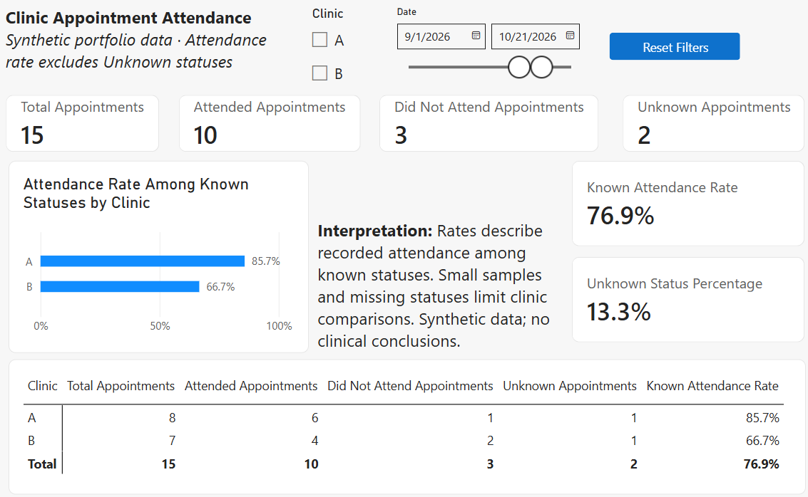
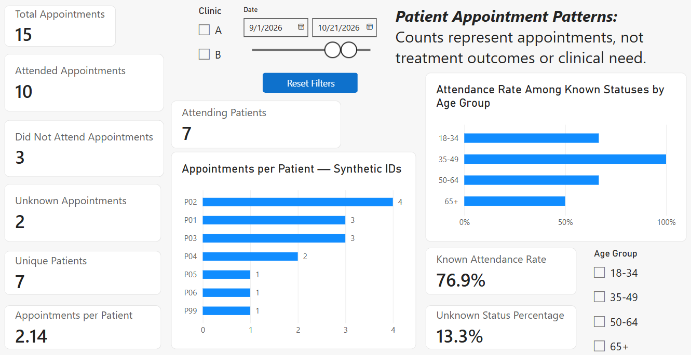
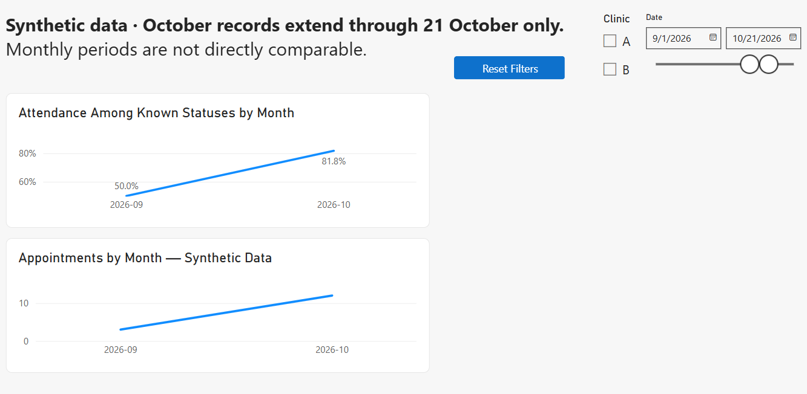

# Clinic Appointment Attendance

An Excel and Power BI portfolio project for exploring appointment attendance, patient activity, and missing attendance records.

Uses entirely synthetic data: 15 appointments across 7 patients and 2 clinics, dated 1 September–21 October 2026.

## Preview






## Tools and workflow

- Excel: source tables, validation, formulas, and summary reporting.
- Power Query: text standardization, missing-status handling, duplicate checks, review queries, appending batches, and patient lookups.
- Power BI: patient, clinic, and date dimensions; DAX measures; synced slicers; tooltips; reset bookmarks; and patient drillthrough.

## Report pages

- Overview: appointment counts, attendance rates, missing statuses, and clinic comparison.
- Patient Detail: appointment frequency and attendance by age group.
- Patient Records: appointment records for a selected patient.
- Monthly Trends: monthly appointment counts and known-status attendance.
- Definitions: metric definitions and refresh instructions.

## Metric definitions

| Metric | Definition |
|---|---|
| Known attendance rate | Attended ÷ (Attended + Did Not Attend) |
| Unknown percentage | Unknown appointments ÷ all appointments |
| Unique patients | Distinct patients with an appointment |
| Attending patients | Distinct patients with at least one attended appointment |
| Appointments per patient | All appointments ÷ unique patients |

Counts return zero for empty selections. Rates return blank when their denominator is zero.

## Verified baseline

With all filters cleared:

- 15 appointments: 10 Attended, 3 Did Not Attend, 2 Unknown.
- 7 unique patients and 7 attending patients.
- 76.9% attendance among known statuses.
- 13.3% Unknown statuses.

## Open and refresh

1. Open Clinic_Appointment_Attendance.pbix in Power BI Desktop.
2. To refresh on another computer, update the Excel source path in Power Query to the included workbook.
3. Edit source records in Excel, refresh its queries, wait for completion, and save.
4. Refresh Power BI.

The PBIX contains imported data that can be explored before refreshing.

## Limitations

This small synthetic dataset demonstrates reporting functionality.
It does not establish clinic performance, demographic effects, treatment outcomes, or clinical need.

October records extend through 21 October only. Monthly counts cover unequal periods. Calendar dates without records do not establish zero clinic activity.

Age groups are fixed reference attributes in this demonstration.


## SQL extension

SQLite stores patients, clinics, and appointments with primary keys,
foreign keys, and approved-status constraints.

The `clinic_attendance_summary` view calculates clinic counts,
known-status attendance rates, and Unknown percentages.

### Files

- `data/appointments.db` — working SQLite database.
- `sql/setup.sql` — snapshot containing schema, sample records, and view.
- `sql/clinic_attendance_summary.sql` — view definition.
- `sql/verify_setup.py` — rebuilds the snapshot in memory and checks
  appointment count and foreign-key integrity.

### Verify the snapshot

From the project folder, run:

```bash
py sql/verify_setup.py
```

Requires Python 3. The baseline contains 15 synthetic appointments.
The verification does not modify the working database.